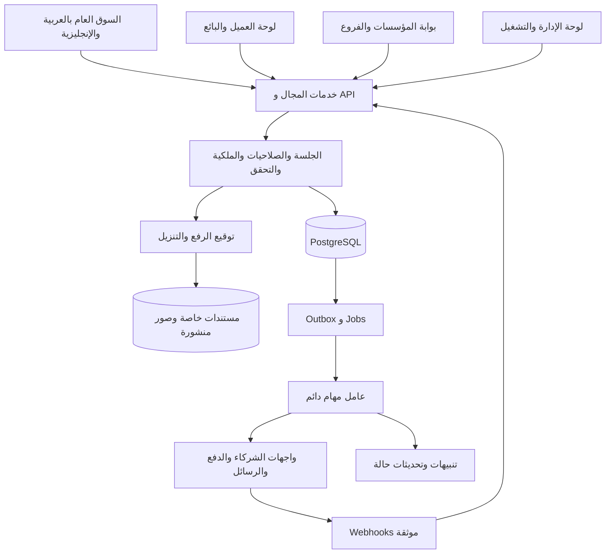
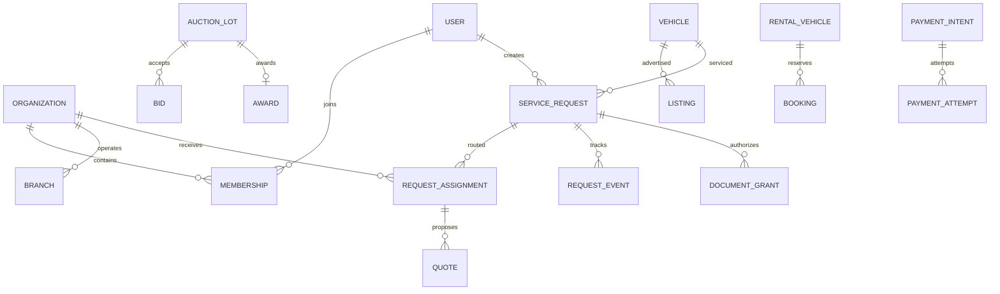

# مواصفات نظام BHD Cars المستهدف

هذه مواصفات تنفيذ مقترحة للمستودع الحالي، بتاريخ12 نوفمبر2026. تُطبق بالترتيب في backlog ولا تعني أن وظائفها موجودة الآن. المتطلبات المكتوبة بصيغة «يجب» هي معايير قبول؛ الخيارات التجارية غير المثبتة موسومة كإعداد أو اعتماد تشغيلي.

## 1. قرارات البنية

1. الاحتفاظ بـNext.js وReact وTypeScript وTailwind وبهوية BHD، وتحديث النسخ إلى إصدارات مدعومة متوافقة بعد تجربة ترقية في فرع مستقل. لا إعادة كتابة شاملة بلغة أخرى ولا microservices مبكرة.
2. تطبيق واحد بوحدات مجال مستقلة: identity، organizations، catalog، marketplace، requests، valuation، inspection، insurance، finance، auctions، rental، commerce، import، billing، communications، operations.
3. PostgreSQL مصدر الحقيقة وPrisma للمخطط والترحيلات والاستعلامات. SQL مباشر مضبوط عند الحاجة إلى locking/exclusion constraints. لا يُستبدل ضبط التزامن بـReact state أو Redis.
4. Better Auth كاختيار أولي للمصادقة والجلسات مع DB adapter؛ تحقق من توافق نسخته المثبتة وNext.js واختبارات الأمان قبل اعتماده. صلاحيات أعمال BHD وملكية الملفات تبقى في طبقة مجال خادمية حتى لو وفرت المكتبة organization plugin. لا تكتب خوارزمية جلسات/OTP/تشفير خاصة.
5. مخزن ملفات متوافق مع S3؛ مستندات خاصة في مساحة خاصة، وصور الإعلانات المنشورة مشتقة إلى مساحة عامة/CDN بعد الفحص. لا ملفات عملاء داخل `public/`.
6. API موحد `/api/v1` مع schemas تحقق مشتركة ومخطط OpenAPI3.1. يمكن استخدام Server Actions داخل الواجهات؛ كلا المسارين يستدعي نفس domain service ونفس فحوص التصريح.
7. جداول Outbox وJobs بمعاملات DB، وworker Node مستقل عن عملية HTTP لتنفيذ التوزيع والرسائل والإغلاق والتسوية. لا timers طويلة داخل Vercel ولا مهام تبدأ بلا await ثم تعتمد على بقاء الطلب.
8. البحث يبدأ بفهارس PostgreSQL وتطبيع عربي/إنجليزي وpagination. إضافة محرك خارجي لاحقًا عندما يثبت قياس الحجم أن قاعدة البيانات لا تحقق هدف البحث. محرك البحث لا يخزن مستندات خاصة.
9. بيئات development وtest وstaging وproduction منفصلة في DB والملفات والرسائل والدفع. لا seed تجريبي في الإنتاج. لا API keys تبدأ بـ`NEXT_PUBLIC_` للخدمات السرية.
10. feature flags خادمية لكل خدمة وسوق ومزود وحالة: `disabled / preview / assisted / integrated`. وضع assisted يعني طلبًا حقيقيًا يتولاه موظف شريك؛ preview يوضح أنه عرض تجريبي ولا ينشئ معاملة مالية.

مراجع التنفيذ: [مصادقة Next.js](https://nextjs.org/docs/app/guides/authentication)، [Better Auth مع Next.js](https://www.better-auth.com/docs/integrations/next)، [المؤسسات](https://www.better-auth.com/docs/plugins/organization)، [معاملات Prisma](https://www.prisma.io/docs/orm/prisma-client/queries/transactions)، [قفل PostgreSQL](https://www.postgresql.org/docs/current/explicit-locking.html)، [روابط S3 المؤقتة](https://docs.aws.amazon.com/AmazonS3/latest/userguide/using-presigned-url.html). تُثبّت نسخ الحزم وتُراجع وثائق النسخة المستخدمة عند التنفيذ.

### مخطط المنظومة



### تنظيم المصدر

```text
src/app/(public)/[market]/[locale]/...
src/app/(auth)/auth/...
src/app/(customer)/account/...
src/app/(partner)/partner/[organizationId]/...
src/app/(admin)/admin/...
src/app/api/v1/...
src/modules/<domain>/{schemas,service,repository,policy,events}.ts
src/server/{auth,db,storage,providers,jobs,observability}/...
src/components/{ui,marketplace,forms,dashboards}/...
src/i18n/{ar,en}.json
prisma/{schema.prisma,migrations,seed.ts}
workers/...
tests/{unit,integration,e2e}/...
docs/{architecture,api,runbooks}/...
```

تنقل الملفات على دفعات، لا يُنشأ هيكل فارغ ضخم. تُحفظ التحويلات للروابط الحالية مع query strings؛ الروابط الخاصة الجديدة لا تحتاج market/locale داخل عنوانها إن استمدته من تفضيلات الحساب والجلسة.

## 2. قواعد الهوية والمؤسسات والصلاحيات

المستخدم شخص واحد؛ يمكنه الشراء والبيع والعضوية في أكثر من مؤسسة. المؤسسة يمكنها ممارسة أكثر من نشاط بعد اعتماد كل نشاط في السوق المحدد. لا تفترض أن لكل إنسان role واحدًا أو أن التسجيل كشركة يعني قبولها تلقائيًا.

### الأدوار

- زائر: قراءة الإعلانات المنشورة ومقارنة عامة وتقديرات معلنة، دون مستندات أو طلبات خاصة.
- عميل/بائع فردي: ملفه وسياراته وإعلاناته وطلباته ورسائله وعملياته فقط. لا يعرض مستندات العميل الآخر لمجرد وجوده كبائع للسيارة.
- مالك مؤسسة: إدارة ملف المؤسسة وطلب الاعتماد والفروع والدعوات والأدوار؛ لا يملك منح نشاط غير معتمد أو تعديل اعتماد المنصة.
- مدير فرع: بيانات الفرع وموظفوه وتكاليفه ضمن تفويضه.
- موظف معرض: المخزون والعملاء المسندون إليه، حسب صلاحيات التحرير والنشر المحددة.
- موظف تأمين/تمويل/تثمين/فحص/مزاد/تأجير/قطع/سكراب/استيراد/ورشة: نطاق خدمته وتكليفه وسوقه ومؤسسته فقط.
- مسؤول حسابات مؤسسة: فواتير وتسويات ومستحقات مؤسسته؛ لا يرى هويات/رواتب العملاء لمجرد دوره المالي.
- دعم المنصة: طلبات حسب التذاكر والتكليف، بيانات شخصية مقنّعة افتراضيًا. كشف مستند حساس يتطلب سببًا وصلاحية وسجلًا ومهلة.
- مراجع محتوى: إعلانات وبلاغات وأدلة النشر؛ لا صلاحية دفع أو ملفات تمويل.
- مسؤول اعتماد: وثائق المؤسسات وقرارات القبول والتعليق وانتهاء الترخيص.
- مسؤول مالي: مدفوعات واستردادات وتسويات؛ تعديل حساب مستفيد/صرف كبير يحتاج موافقة ثانية من مخول مختلف.
- مسؤول تشغيل/مدير سوق: توزيع الطلبات وSLA وحالات السوق؛ لا يمتلك تلقائيًا صلاحية كل دولة.
- مسؤول أمني: جلسات وتدقيق وإعدادات أمن؛ لا تعديل مبالغ أو إخفاء آثار مالية.
- مدير نظام أعلى: إدارة التفويضات والتكوينات الحساسة ضمن MFA وتدقيق؛ حساب طوارئ مضبوط منفصل عن الاستخدام اليومي.

كل تصريح = action + resource + ownership/organization + market + assignment + state. أمثلة أسماء permissions: `listing.update_own`، `request.read_assigned`، `quote.issue`، `policy.attach`، `valuation.sign`، `auction.close`، `refund.approve`، `organization.verify`.

يُرفض الطلب افتراضيًا. يستخرج الخادم العضوية من الجلسة، ولا يثق في `organizationId` أو role قادم من body. يطبق الحماية على API والوظائف الخلفية والتحميل والتصدير والبحث، لا الصفحة وحدها. الحساب المعلق أو العضوية الملغاة لا يستمر بتفويض قديم مخزن داخل جلسة طويلة.

### رحلة الشريك

تسجيل حساب → إنشاء مؤسسة → تعريف قانوني وبيانات اتصال وفروع → اختيار الأنشطة والأسواق → رفع أدلة الهوية والترخيص/الاعتماد المناسبة للنشاط → موافقات وشروط وعقد → مراجعة بشرية → قبول نشاط محدد أو طلب نواقص أو رفض مسبب → تفعيل مستخدمين وفروع → متابعة انتهاء الأدلة وإعادة التحقق.

الشارة تربط بنشاط وسوق ودليل وفترة صلاحية. انتهاء الترخيص يمنع إسنادًا جديدًا وإصدار مخرجات جديدة، مع إحالة الطلبات القائمة للتشغيل وسياسة معالجة معلنة. لا تحذف الطلبات التاريخية ولا تعرض مستند اعتماد خاص للعموم.

## 3. نموذج البيانات

لكل سجل أساسي ID غير قابل للتخمين و`createdAt/updatedAt`؛ الأحداث `occurredAt` من الخادم. المراجع البشرية فريدة بقيد DB وليست بديلًا للمصادقة. لا تسوّى الأموال أو الحالات من نص مترجم في `detail`.

### الهوية والمؤسسات

- `User`: الاسم، هاتف بصيغة E.164، بريد، تحقق، locale، timezone، status. لا إلزام ببيانات مالية قبل الحاجة إليها.
- `Session` وMFA وverification tokens عبر مكتبة المصادقة؛ أسرار OTP لا تخزن كنص مكشوف في سجلات التطبيق.
- `Organization`: الاسم القانوني/التجاري، slug، بلد تسجيل، status، صاحب الحساب؛ قد تكون متعددة الأنشطة.
- `Membership`: userId، organizationId، roles، status؛ unique(userId, organizationId).
- `Branch` و`MembershipBranch`: موقع ونطاق تشغيل وصلاحيات فرع.
- `OrganizationActivity`: activity، marketId، accreditationStatus، validFrom/validUntil، reference، evidenceDocumentId.
- `PartnerContract`: إصدارات شروط ونسب عمولة وSLA وطرق integration وسياسة تسوية؛ محصور ماليًا وتشغيليًا.
- `Invitation`: token مشفر/مجزأ، بريد/هاتف مستهدف، صلاحيات مسموحة، expiry، consumedAt؛ الدعوة لا تسمح بتصعيد صلاحيات الداعي.
- `AuditEvent`: actor، impersonator إن وجد، action، resource، organization، سبب، diff منقح، correlationId، timestamp؛ append-only بصلاحيات منفصلة.

### الأسواق والكتالوج والسوق

- `Market`: country، locale/default currency، timezone، enabled services، publishing rules.
- `CurrencyMetadata` و`FxRate`: كود العملة ودقتها، pair، rate decimal، source، capturedAt، validUntil. يحتفظ الدفع بعملته الأصلية وتحتفظ الفاتورة بالـsnapshot.
- `Make` → `Model` → `Generation` → `Trim`: معرفات ثابتة وترجمات وأنواع هيكل وسنوات ونطاق بلد. `CatalogAsset`: مسار موجود ونوع illustration/photo/source/license/hash.
- `Vehicle`: makeId/modelId/trimId، year، mileageValue/unit، exterior/interior، body/fuel/gearbox/drive/cylinders كحقول typed، VIN مشفر أو وصول محصور، VIN public visibility، مواصفات مصدرها ومن تحقق منها.
- `VehicleOwnership`: المستخدم/المؤسسة صاحبة الملف وأدلة الملكية/التفويض. معرفة VIN لا تمنح ملكية ملف سابق؛ لا ربط تلقائي لوثائق مالك سابق عند إدخال VIN مطابق.
- `Listing`: vehicleId، ownerUserId أو ownerOrganizationId مع CHECK XOR، branchId عند المؤسسة، marketId، current location، priceAmountMinor، currency، negotiable/priceOnRequest، saleType، status، publishedAt/expiresAt/soldAt، version.
- `ListingRevision` و`ModerationDecision`: snapshot ومبررات تعديل/رفض ومراجع موظف. السعر الحالي لا يعيد كتابة عقد أو عرض سابق.
- `ListingMedia`: fileId، ترتيب، cover flag، نوع الصورة/قبل/بعد؛ لا صورة blob. `DamageDisclosure`: مناطق، severity، flood/fire/airbags، running/repair/title states، source وإقرار البائع.
- `Favorite` و`SavedSearch` و`Comparison`: للمستخدم؛ unique مناسب، تنبيهات بحث بمهلة opt-in، منع كشف إعلانات غير منشورة عبر المقارنة.
- `Lead` و`Conversation` و`Message` و`Participant`: أطراف محددون وروابط السيارة/الطلب وقيود ملفات ورسائل. لا يضيف مستخدم نفسه لمحادثة بمعرفة ID.
- `Review`: مرتبط بتسليم/معاملة حقيقية، مراجعة واحدة لكل طرف ودور، بلاغ ورد؛ تقييم ليس بديل اعتماد.

### الطلبات والخدمات

- `ServiceRequest`: customerId، kind، marketId، vehicleId/listingId إن وجد، status، correlationId، version، timestamps؛ مجموعات معلومات مهيكلة وليست نصًا وحيدًا.
- `RequestConsent`: غرض ونسخة نص وتاريخ واختيار الجهات التي يسمح للعميل بمشاركة البيانات معها، وسجل سحب الموافقة وآثاره.
- `RequestAssignment`: requestId، organizationId، branchId، assigneeId، stage، deadlineAt، respondedAt، response؛ يحتفظ بتاريخ الإسناد/الانسحاب، لا مجرد overwrite.
- `Quote`: provider organization، request/assignment، service kind، amountMinor/currency، breakdown، termsVersion، expiresAt، providerRef، source(api/portal)، status، version. العرض من نفس السوق والنشاط المعتمد.
- `QuoteAcceptance`: requestId، quoteId، quoteVersion، customerId، acceptedAt؛ قيد قبول عرض واحد حيث الخدمة لا تسمح بأكثر، معاملة DB عند السباق.
- `RequestEvent`: حالة سابقة/جديدة، actor، reason، visibility، وقت؛ الرسالة العامة لا تحتوي ملاحظات داخلية أو أسرار مزود.
- جداول امتداد typed لكل خدمة: `ValuationOrder/Report`، `InspectionBooking/Report`، `FinanceApplication/Decision`، `InsuranceApplication/Policy/Claim`، `ImportOrder/Milestone`، `ServiceAppointment/WorkOrder`، `HistoryReportOrder`، `PlateTransferRequest`، `ScrapOrder`.
- `ReportVersion`: بنود مهيكلة وصور ونتيجة ومنهجية ومُصدر وتوقيع/اعتماد وملف PDF وverificationToken. التعديل بعد الاعتماد يصدر نسخة لاحقة ويعلن أن السابقة مستبدلة.
- `Document`: owner، classification، objectKey، hash، mime، size، scanStatus، retentionUntil، accessPolicy. `DocumentGrant`: resource/grantee/purpose/expiry/revokedAt؛ لا URL دائم في الرسائل.

### المزاد والتأجير والتجارة والمال

- `AuctionSession` و`AuctionLot`: owner org/market، vehicleId، startsAt/endsAt UTC، opening/reserve/increment، fees snapshot، currency، state، version. reserve خاص؛ API العام يكشف تحقق الحد فقط.
- `BidderRegistration` و`BidderDeposit`: هوية وأهلية وKYC إن اشترطه التشغيل، status وضمان confirmed/reserved/released/forfeiture_review. لا مصادرة تلقائية بمجرد تأخر job.
- `Bid`: lotId، bidderId، amountMinor، sequence، acceptedAt، idempotencyKey، source؛ unique(lotId, sequence) وunique(bidderId, lotId, idempotencyKey). سجل لا يعدل بعد قبوله؛ الإبطال بحدث مسبب.
- `Award` و`Settlement` و`Handover`: فائز واحد لكل لوت، التزام دفع ومواعيد وشروط وتسليم ونزاع. لا تغيير الفائز بعد التحصيل دون عملية نزاع وتدقيق.
- `RentalVehicle` و`RentalRatePlan` و`AvailabilityBlock` و`Booking`: فرع/سيارة فعلية، startsAt/endsAt، السعر والتغطية والحد والضمان snapshot، حالة؛ منع تداخل حجوزات السيارة المؤكدة والـholds الفعالة بقيد أو قفل DB.
- `RentalCheckOut/CheckIn`: صور وعداد ووقود وأضرار وتوقيع، احتساب زيادات بموافقة موثقة وشروط العقد.
- `PartSku`: OEM، manufacturer، condition، warranty، fitment mappings، مخزون فرع. VIN يدعم الاقتراح ولا يضمن التوافق لكل مركبة.
- `InventoryReservation` و`Order/OrderItem` و`Shipment/Return`: كميات وأسعار وضريبة وشحن وعنوان خاص، مدد حجز ومخزون متاح بعملية ذرية.
- `PaymentIntent/PaymentAttempt/Refund`: مرجع مزود، مبلغ وعملة وخدمة/عقد، idempotency، حالات؛ card data لدى PSP ولا تسجل PAN/CVV في BHD.
- `Invoice/InvoiceLine/CreditNote`: ترقيم محصور بالسوق، أرقام غير معاد استخدامها، immutable بعد الإصدار؛ التعديل بمستند عكسي.
- `LedgerAccount/LedgerTransaction/LedgerEntry`: قيود متوازنة لكل عملة، تفصل أموال العملاء/الضمان/الشريك/عمولة المنصة والرسوم/المبالغ المستردة. لا تسمية هذا «محفظة مالية مرخصة»؛ هو دفتر تسوية داخلي.
- `ProviderEvent`: provider/eventId فريد، payload hash، signature result، receivedAt، processing status؛ payload حساس بتشفير وصلاحية محدودة وretention.
- `OutboxEvent/JobAttempt/DeadLetter`: eventId فريد، نوع ونسخة payload، attempts، nextRunAt، lease، lastError منقح.

### علاقات رئيسية



## 4. دورة الطلب ومحرك توزيع المثمنين والشركاء

غلاف الطلب المشترك: `draft → submitted → routing → awaiting_provider → in_progress → completed`. الفروع: `awaiting_customer` و`cancelled` و`rejected` و`failed` و`disputed`. «quoted» مرحلة داخل الخدمة وليس دليل إكمال. لكل خدمة state machine خاصة أدناه؛ لا يسمح endpoint عام بتعيين أي status حسب رغبة العميل.

طلب التثمين التلقائي يعني **توزيعًا آليًا على مثمنين معتمدين**، ولا يعني تقرير اعتماد مولدًا من معادلة سعر. يجوز مستقبلًا عرض تقدير آلي مستقل مع حدود ثقته وبياناته ومنهجيته.

خوارزمية التوزيع الملزمة:

1. يتحقق الخادم من العميل والسيارة والغرض والمدينة والسوق والموافقات والحقول المطلوبة. تثبت نسخة البيانات وقت الإرسال.
2. يرشح جهات ذات نشاط فعال وأدلة اعتماد سارية ونطاق جغرافي وخبرة فئة المركبة وعدم تضارب مصالح وسعة عمل متاحة.
3. ترتيب محدد قابل للتفسير: أهلية إلزامية، ثم ملاءمة الموقع/التخصص، ثم سعة وSLA وسجل تسليم، ثم أقدم آخر إسناد لكسر التعادل. لا أفضلية خفية للإعلانات المدفوعة.
4. تخصيص تلقائي افتراضي إلى جهة واحدة بمهلة قبول قابلة للتكوين، مثال تشغيلي أولي30 دقيقة ضمن ساعات العمل؛ يحفظ السبب ونسخة القاعدة.
5. انتهاء المهلة/الرفض يغلق assignment السابق وينشئ التالي دون ازدواج فعال. job يحمل نسخة الطلب ويعيد فحص الحالة داخل المعاملة قبل التغيير.
6. فشل جميع المرشحين ينقل الطلب إلى موظف التشغيل ويعرض للعميل عدم توفر مزود حاليًا؛ لا يقول «المثمن استلم».
7. إذا اختار العميل «قارن عروض مثمنين»، يسلك نمط multi-provider صريحًا مع موافقاته، وحد أقصى3 دعوات فعالة افتراضيًا ومدة عرض. لا يخلط بين طلب خدمة مسندة وطلب أسعار متعدد.
8. تسليم البيانات يكون بأقل قدر: المدينة ونوع السيارة يكفيان أوليًا؛ الهوية/عنوان دقيق/مستند مالي بحسب الحاجة والموافقة والتكليف.
9. قبول عرض أو تكليف نهائي يقفل بقية التكليفات/العروض المناسبة ويعكس الحجز غير المستخدم. لا يتسابق موظفان لتعيين شريكين لنفس المهمة.
10. لوحة التشغيل تعرض السبب والمهلة والتأخر وإعادة الإسناد وسجل كل محاولة. الإشعارات تنشأ من outbox؛ فشل SMS لا يفقد الطلب.

## 5. لوحة المستخدم كاملة

كل شاشة لها loading/error/empty/permission-denied وحفظ آمن ورسائل توضح النتيجة الحقيقية. عناصر الإدارة لا تظهر في لوحة العميل.

- `/auth/sign-in` و`/auth/verify` و`/auth/recovery`: هاتف/بريد حسب المزود، تحقق، عودة آمنة إلى وجهة داخلية بعد الدخول، تحديات rate-limit، استرداد، MFA للمخولين. لا redirect إلى رابط خارجي من query.
- `/account`: ملخص إعلاناتي، طلباتي، عروض تحتاج قرارًا، مواعيد وفواتير غير مسددة وتنبيهات. الأرقام من استعلام scoped لا أرقام ثابتة.
- `/account/profile`: اسم وهاتف وبريد ولغة ومنطقة زمنية وعناوين؛ تغيير هاتف أو بريد بإعادة تحقق، لا فقدان جلسة كل الأجهزة دون إعلام.
- `/account/security`: جلسات وأجهزة وإلغاء جلسة وتفعيل/استرداد MFA وإشعارات تغيرات حساسة.
- `/account/vehicles` و`/[id]`: مرآبي، إضافة مركبة خارج السوق، مصادر مواصفاتها، وثائقها وخدماتها؛ مشاركة تقرير معين بمدة ونطاق دون مشاركة ملف المالك كله.
- `/account/listings`: مسودات/مراجعة/منشورة/مرفوضة/منتهية/مباعة؛ إنشاء، تعديل، معاينة، تجديد، سحب، تحديد مباعة. سبب رفض واضح وحق إعادة الإرسال.
- `/account/listings/[id]/edit`: نفس معالجات البيع بعد ربطها؛ autosave موثوق ورفع progress وترتيب الصور والعودة للمسودة من جهاز آخر.
- `/account/favorites` و`/account/saved-searches`: إدارة الحفظ والتنبيهات وتكرارها وسحب الاشتراك؛ إظهار أن الإعلان بيع/انتهى دون تسريب محتواه الخاص.
- `/account/compare`: حفظ مقارنة الحساب، وحتى3 سيارات بدايةً؛ مقارنة حقول محددة و«غير متوفر» حيث يلزم.
- `/account/requests`: بحث وفلترة نوع/حالة/سيارة/تاريخ، pagination؛ لا تعرض طلبات المؤسسة لمجرد أن صاحب الحساب عضو فيها.
- `/account/requests/[id]`: timeline، جهة متاحة أو غير مسندة، نواقص، عروض، قبول/رفض بسبب، موافقات، رسائل، مواعيد، ملفات مصرح بها، فاتورة، إلغاء وشكوى. تفاصيل مبلغ وعملة ورسوم وإصدار شروط قبل أي قبول ملزم.
- `/account/quotes/[id]`: مقارنة نطاق الخدمة والاستثناءات والتحمل والمواعيد والسعر النهائي وصلاحية العرض؛ زر قبول يتأكد من version وexpiry خادميًا.
- `/account/documents`: قائمة حسب المركبة/الطلب ونوع الملف، حالة الفحص، صلاحيات المشاركة وسحبها. لا ترسل الهوية إلى كل شريك بمجرد رفعها مرة.
- `/account/policies` و`/[id]`: وثائق تأمين صادرة من المزود، التغطية وتاريخ البدء/الانتهاء والتنزيل وتجديد/طلب تعديل/إلغاء/مطالبة؛ لا تُعرض وثيقة من إيصال دفع فقط.
- `/account/finance`: الطلبات والمستندات الناقصة وحالة موافقة/عقد/صرف. لا يظهر «تم التمويل» عند موافقة مبدئية.
- `/account/auctions`: أهلية وتأمينات وتسجيل ومتابعة ومزايدات وترسية ومواعيد سداد وتسليم؛ إظهار ارتباط كل ضمان باللوت/الجلسة وفق الشروط.
- `/account/bookings`: تأجير وفحص وصيانة، تقويم وتغيير موعد ضمن السياسة، عقد وتسليم/استلام؛ التغيير يعيد فحص التوفر.
- `/account/imports/[id]`: عروض سيارات وتكلفة كاملة وموافقات ومراحل شراء/شحن/تخليص وتسليم ومرفقات وفروقات سعر معلنة.
- `/account/orders/[id]`: قطع وشحن وإرجاع واسترداد؛ لا يمكن إعلان «تم الشحن» من مجرد إنشاء طلب.
- `/account/billing`: مدفوعات وفواتير وإشعارات دائنة واستردادات وتأمينات ضمان، مبالغ أصلية وحالة حقيقية. لا جمع عملات مختلفة في إجمالي واحد دون تحويل معلن.
- `/account/messages` و`/[id]`: محادثات خاصة وأطرافها وحظر/بلاغ، مرفقات محمية؛ قراءة تتطلب عضوية conversation الحالية.
- `/account/notifications` و`/account/preferences`: مركز تنبيهات وإعدادات قنوات وموافقات تسويق منفصلة عن تنبيهات المعاملات.
- `/account/support` و`/[ticketId]`: تذاكر وموضوع/خدمة/ملفات/ردود ومهلة متوقعة وتصعيد ونزاع.
- `/account/privacy`: سجل موافقات، تنزيل بيانات وفق السياسة، طلب تصحيح/حذف، وتوضيح ما يلزم الاحتفاظ به للمعاملات الجارية. التنفيذ النهائي يتبع سياسة سوق معتمدة ولا يدّعي حكمًا قانونيًا من هذه المواصفة.

## 6. بوابة الشركات المشتركة

الجذر `/partner/[organizationId]`. الهيكل ثابت لكل مؤسسة، والقائمة تتغير بصلاحياتها وأنشطتها المعتمدة. لا تبنَ نسخة تطبيق مستقلة لكل قطاع.

- الرئيسية: طلبات جديدة، مهام متأخرة، مؤشرات تسليم، عروض منتهية، مواعيد، تنبيهات ترخيص وتسوية؛ scoped للفرع/الموظف.
- `onboarding` و`profile` و`accreditations`: تعريف المؤسسة والأنشطة والأدلة وإعادة التجديد وقرار الاعتماد؛ لا زر «اعتماد نفسي».
- `branches` و`team` و`roles`: فروع وتغطية ودعوات وإلغاء عضوية ومصفوفة تفويض. تسجيل من غيّر صلاحية ومن وافق عليها.
- `inbox` و`requests/[id]`: صف طلبات، قبول/اعتذار، إسناد موظف مخول، طلب نواقص، رد ومرفقات؛ مهلة قبول وعدّاد مشتق من deadline خادمي.
- `quotes` و`quotes/[id]`: مسودة عرض، بنود سعر، شروط، ضرائب ورسوم، صلاحية، إصدار، سحب قبل القبول؛ لا تعديل صامت بعد القبول.
- `calendar` و`capacity` و`coverage`: ساعات وأيام عمل وعطل ومقاعد ومناطق وفئات سيارات وحد استقبال؛ لا إسناد في منطقة غير مخدومة.
- `customers`: عملاء تعاملوا مع المؤسسة ضمن نطاق التكليف والاحتفاظ؛ لا دليل كل مستخدمي BHD.
- `documents` و`reports`: الملفات الممنوحة للمؤسسة ومخرجاتها فقط، تنزيل محمي ومراقب.
- `billing` و`settlements`: عمولات وفواتير ومستحقات وسجل دفع واستردادات وتصدير محكوم؛ تعديل المستفيد بإعادة تحقق ومراجعة مستقلة.
- `analytics`: عدد الطلبات والقبول ومدة أول رد وتسليم وقيمة صافية حسب عملة/فرع/فترة، بتعريف واضح لكل رقم.
- `integrations`: حالة ربط ومفاتيح خادمية لا تعرض كاملة وwebhook health وإعادة تسليم آمنة؛ sandbox مستقل؛ لا يحتاج الشريك العادي رؤية أسرار تكامل.
- `settings` و`audit` و`support`: تفضيلات وتنبيهات وتدقيق المؤسسة وتذاكر؛ لا وصول لتدقيق مؤسسة أخرى.

## 7. صفحات الشركات المتخصصة ودورات العمل

### 7.1 شركات التأمين

الشاشات: `insurance/products`، `applications`، `applications/[id]`، `underwriting`، `quotes`، `policies`، `endorsements`، `renewals`، `claims`، `cancellations`، `reconciliation`.

الحقول: نوع المنتج والسوق والتغطية، الاستخدام، بيانات السيارة/المؤمن له/السائق بحسب المزود، سعر شامل الرسوم، التحمل، حدود وأخطار واستثناءات وإصلاح وكالة/شبكة وطرق مساعدة، startAt/endAt، المستندات المطلوبة، quote/provider reference وإصدار النص المعتمد. لا يصنع موظف BHD تسعيرة تلقائيًا باسم الشركة دون تفويض.

الدورة: draft → submitted → awaiting_documents → underwriting → quoted → accepted → payment_pending أو issuance_pending بحسب عقد المزود → issued → active → expired/cancelled. الدفع والإصدار حالتان مستقلتان؛ نجاح إحداهما لا يستنتج الأخرى. توجد branches: declined، quote_expired، issuance_failed، refund_pending/refunded. الوثيقة النشطة تتطلب تأكيد المزود وتاريخ بدء صالح، لا صفحة نجاح الدفع.

المطالبات: فتح برقم وثيقة وحادث ومرفقات وموافقة مشاركة → إحالة للشركة → طلب نواقص/مراجعة → قرار من المصدر → متابعة تسوية/رفض مسبب. لا تعد المنصة تعويضًا من تلقاء نفسها.

القبول القطاعي: انتهاء عرض يستلزم إعادة تسعير وموافقة جديدة؛ خصم دفع ثم فشل إصدار يفتح reconciliation ولا خصم ثاني؛ وثيقة PDF متاحة فقط للمخولين؛ التجديد يولد معاملة جديدة مع ربط السابقة.

### 7.2 البنوك وشركات التمويل

الشاشات: `finance/products`، `eligibility-rules`، `applications`، `document-review`، `offers`، `decisions`، `contracts`، `disbursements`، `reconciliation`.

الحقول: المنتج والسوق والعملات، حد مبلغ/عمر سيارة/مدة/مقدم، نوع معدل flat/reducing/غيره بحسب العقد، رسوم وضرائب وتأمينات إلزامية، القسط والدفعة الأخيرة وإجمالي التكلفة، أهلية إقامة/عمل/دخل والتزامات ومستندات وموافقة مشاركة. لا يعامل `APR` في نموذج تجريبي على أنه إجمالي كلفة منتج حقيقي.

الدورة: submitted → awaiting_documents → eligibility_review → provider_review → conditional_approval → final_offer → accepted → contract_pending → signed → disbursement_pending → disbursed. الفروع declined/withdrawn/expired/cancelled. القرار وإثباته وهوية موظف الجهة محفوظة؛ خطاب الموافقة المبدئية منفصل عن العقد والصرف.

القبول القطاعي: بيانات الراتب لا تظهر لشركة تأمين أو معرض؛ رفض مزود لا يتحول لموافقة بتغيير client status؛ لا صرف بلا إثبات مزود وربط مستفيد صالح.

### 7.3 المثمنون

الشاشات: `valuation/inbox`، `assignments`، `calendar`، `vehicles/[id]`، `comparables`، `report-editor`، `approval-queue`، `reports`، `amendments`.

الحقول: الغرض، scope حضوري/مكتبي، السيارة والموقع والمالك/التفويض، صور وممشى ومصدر المعلومات، مقارنات قابلة للإثبات، منهج وتعديلات، نطاق قيمة وعملة وتاريخ تقييم وصلاحية، شروط وحدود، مثمن معتمد وتوقيع/اعتماد وتقرير PDF.

الدورة: routed → accepted → information_pending → scheduled إن لزم → evaluating → report_draft → reviewer_approved حسب سياسة المؤسسة → delivered → amendment_requested/amended أو closed. غرض نزاع/تمويل لا يضمن قبول الجهة المستفيدة للتقرير؛ يلزم نشاط معتمد لغرضه وسوقه.

القبول القطاعي: auto-routing يرفض الاعتماد المنتهي، تقرير مُسلم immutable، رابط تحقق يعرض أصالة الإصدار والجهة والتاريخ بأقل بيانات ولا ينشر هوية المالك أو PDF كاملًا.

### 7.4 مراكز الفحص والفاحص بالنيابة

الشاشات: `inspection/bookings`، `dispatch`، `inspectors`، `checklists`، `report-editor`، `quality-review`، `reports`، `reinspection`.

الحقول: موافقة البائع على الوصول والتصوير وتجربة الطريق، تفويض طالب الفحص، موقع آمن ووقت متاح، checklist بحسب نوع السيارة، VIN مطابق، عداد وطلاء/شاصي/ميكانيك/OBD/مكابح/وسائد/إطارات، بطارية EV إذا مدعومة، صور مرتبطة بالبند وseverity وnot-tested وأسبابها، توصيات وحدود الفحص.

الدورة: requested → seller_consent_pending → slot_held → confirmed → inspector_assigned → inspecting → quality_review → report_delivered → completed. الفروع seller_declined/no_show/rescheduled/cancelled/refund_review. لا تدفع العميل للاعتقاد أن عبارة «موعد مبدئي» حجزت موردًا بالفعل.

القبول القطاعي: منع ازدواج الفاحص/الموعد، كشف عدم مطابقة VIN يوقف التسليم المعتاد ويصعد للمشرف، «لم يُفحص» لا يتحول إلى ناجح، تقرير الفحص ليس ضمانًا خاليًا من القيود.

### 7.5 شركات المزادات

الشاشات: `auctions/sessions`، `lots`، `lot-review`، `bidders`، `deposits`، `live-console`، `bid-history`، `awards`، `invoices`، `settlements`، `handovers`، `disputes`.

قواعد مطلوبة: ملكية/تفويض البيع، حالة ضرر ووثائق لوت، كشف الرسوم والضريبة واحتياطي/حد أدنى وسياسة الإلغاء قبل التسجيل، عملة أصلية واحدة للمزاد، أهلية وضمان مؤكد، منع مزايدة البائع وموظفيه على لوتهم، سجل مراقبة لا يعدل.

الخوارزمية عند `POST /auctions/lots/:id/bids`: مصادقة وschema → معاملة DB → قفل اللوت → إعادة قراءة ساعة DB وحالة اللوت والأهلية والضمان → فحص amount والحد ومفتاح التكرار → إدراج Bid وتحديث high bid/version وendsAt عند قاعدة تمديد معلنة → كتابة outbox → commit → رد authoritative. تكرار نفس المفتاح ونفس payload يعيد نفس النتيجة؛ payload مختلف يعيد409. WebSocket/SSE أو polling يحسن العرض فقط؛ إعادة الاتصال تسحب snapshot وتسلسل الأحداث من الخادم.

دورة اللوت: draft → under_review → scheduled → live → closing → awaiting_seller_acceptance إذا لم يتحقق الاحتياطي وبحسب الشروط، أو awarded / reserve_not_met / no_sale → payment_pending → paid → handover_pending → completed. فرعا cancelled/disputed مساران مضبوطـان. جدولة الإغلاق وendpoint المزايدة يتفقان على قفل ونهاية واحدة؛ job مكرر لا يصدر فائزين أو فواتير متعددة.

القبول القطاعي:100 طلب مزايدة متزامن في اختبار staging بتدرج أسعار معلوم ينتج ترتيبًا صحيحًا وفائزًا واحدًا، والطلب المتأخر يرفض حتى إن وصل قبل تأخر job الإغلاق. الإبطال الإداري حدث معلل يحتاج دورًا مخولًا ولا يحذف bid.

### 7.6 المعارض

الشاشات: `inventory`، `bulk-import`، `listing-review`، `leads`، `appointments`، `team`، `subscriptions`، `promotions`، `performance`، `public-profile`.

استيراد CSV محدود ومتحقق مع dry-run وبيان أخطاء؛ manifest صور مأذونة دون تنزيل URLs داخلية عشوائية، مخزون مرتبط بفرع وسيارة وحالة، نشر/إيقاف/مباع، توزيع leads، حجز معاينة، موافقة مشاركة إحالة تمويل/تأمين، اشتراكات وفواتير وترويج موسوم. لا يدعي البائع أن بطاقة سعر BHD تثمين معتمد.

### 7.7 شركات التأجير

الشاشات: `rental/fleet`، `rates`، `availability`، `bookings`، `contracts`، `checkout`، `checkin`، `deposits`، `charges`، `maintenance`.

الحقول: تواريخ ومواقع الاستلام/التسليم وtimezone، عمر/رخصة وأهلية، سيارة محددة أو فئة مع سياسة استبدال معلنة، السعر الإجمالي لا اليوم وحده، حد km وتغطية وتحمل وضمان ورسوم تأخير/زيادة وسياسة إلغاء.

الدورة: inquiry → held بمهلة → awaiting_provider إن تأكيد يدوي → confirmed بعد أهلية وتوفر ودفع مطلوب → contract_signed → checked_out → checked_in → charges_reviewed → deposit_released → closed. الـhold المنتهي يحرر المورد آليًا؛ الفشل بعد الدفع يصالح ويعالج قبل تأكيد بديل.

### 7.8 القطع والسكراب

الشاشات للقطع: `parts/catalog`، `fitment`، `inventory`، `rfqs`، `quotes`، `orders`، `shipping`، `returns`، `warranty`.

طلب OEM/صورة/VIN → عروض مطابقة موضحة → قبول وحجز كمية → دفع → تجهيز → شحن/تسليم → فترة إرجاع → إغلاق. اختيار MVP التجاري: طلب عروض متعدد الموردين أولًا؛ السلة متعددة البائعين تؤجل حتى اكتمال تسوية كل بائع وشحنه واسترداده.

الشاشات للسكراب: `scrap/requests`، `estimates`، `pickups`، `weigh-ins`، `ownership-checks`، `certificates`، `settlements`.

ملكية/تفويض وصور وموقع → تقدير موضح الافتراضات → قبول استلام → وزن وتقييم نهائي → قبول فرق السعر من العميل → تسليم وإثباتات وإجراء إسقاط وفق السوق والشريك → تسوية. لا يحتسب سعر طن ثابت كعرض شراء نهائي للسيارة كلها.

### 7.9 الاستيراد والشحن والتخليص

الشاشات: `import/requests`، `sourcing`، `candidate-vehicles`، `cost-sheets`، `purchase-approvals`، `shipments`، `customs`، `documents`، `delivery`، `claims`.

الحقول: مصدر ووجهة وميناء وميزانية وعملة وحالة ضرر مقبولة ومواصفات وقيود أهلية سيارة حسب سوق معتمد، تكلفة سيارة وعمولة مزاد/مكتب ونقل داخلي وشحن وتأمين وتخليص/ضرائب وفحص/إصلاح مقدر وصرف واحتياط. كل بند له مصدر وهل هو تقديري أو مؤكد وتاريخ صلاحية. لا تثبيت نسب جمركية من الذاكرة.

الدورة: submitted → sourcing → options_presented → customer_approved_vehicle_and_budget → purchase_pending → purchased → export_ready → shipped → arrived → clearance → inspection → delivered. الفروع cancelled/purchase_failed/shipping_delay/damage_dispute/budget_reapproval. تجاوز سقف التكلفة يحتاج قبول نسخة جديدة؛ لا شراء أو دفع خارجي من مجرد إبداء اهتمام.

### 7.10 الورش وتقارير التاريخ واللوحات

الورش: خدمات وتسعير وتقويم وأوامر عمل وقطع وموافقة زيادات وفواتير وتسليم؛ الحالات requested → booked → diagnosed → estimate_approved → working → ready → delivered. إصلاح إضافي يحتاج موافقة موثقة قبل التنفيذ.

تقارير التاريخ: كتالوج مصادر وتغطية حسب بلد، quote عند توفر المصدر، تحقق VIN وموافقة → payment_if_required → provider_pending → delivered/not_found/failed → refund_review إن يلزم؛ لا وصف تقرير تاريخ بأنه فحص ميداني أو شامل لكل حادث.

اللوحات: إضافة/مراجعة ملكية/نشر/حجز تفاوض/طلب نقل/إثبات إجراء/إغلاق؛ قواعد رمز وطول وفئة لكل سوق، بيانات مالك خاصة، والمتابعة منفصلة عن سلطة تنفيذ نقل حكومي.

## 8. لوحة الإدارة كاملة

الجذر `/admin`؛ تخطيط عمل منفصل عن واجهة التسوق، وقائمة بحسب دور الموظف.

- `overview`: الطلبات المتأخرة وغير المسندة، إخفاق التكامل/الدفع، تراخيص قرب الانتهاء، مراجعات محتوى، مؤشرات ماليّة بحسب عملة. الأرقام لها تعريف ومصدر ونافذة زمنية.
- `users` و`users/[id]`: ملف حالة وتحقق وجلسات وطلبات مرتبطة ضمن الصلاحية؛ تعليق مع سبب وأثره؛ منع حذف أثر معاملة مالية. الدعم لا يعيد تعيين MFA بلا إجراء استرداد موثق.
- `organizations` و`organizations/[id]`: نشاط/سوق/فرع/أعضاء/اعتماد/عقود وصلاحيات ونواقص وتاريخ قرار؛ عدم تحويل شركة عامة تلقائيًا إلى شريك معتمد.
- `accreditations`: queue واعتماد/رفض/طلب نواقص/تعليق وتجديد مع دليل وتاريخ ومراجع؛ منع الموظف من اعتماد مؤسسته الخاصة.
- `listings` و`moderation`: نسخ إعلان، صور، مستند ملكية أو تفويض عند اللزوم، إفصاح ضرر، duplicate/fraud signals، قبول/رفض مسبب، استئناف، بلاغات وسجل إجراء.
- `requests` و`requests/[id]`: استعراض نوع وسوق وحالة وإسناد وSLA، نواقص وتاريخ وأخطاء وشكاوى؛ override استثنائي مبرر يتحقق من state machine ولا يكتب حالة عشوائية.
- `dispatch` و`provider-capacity`: طابور غير مسند، سبب استبعاد، توزيع تلقائي/يدوي وإعادة إسناد، ساعات وخريطة تغطية؛ إظهار minimum disclosure.
- `insurance` و`finance` و`valuation` و`inspection`: إدارة كتالوجات الخدمة والسياسات والمخرجات والصلاحيات ومراقبة التكامل، دون إصدار قرار شريك مزيف.
- `auctions`: موافقة جلسات/لوتات، مراقبة أهلية وضمان ومزايدات وترسية وسداد وتسليم، حوادث تشغيل؛ لا تعديل مخفي لوقت النهاية/الرسوم بعد البداية.
- `rental` و`commerce` و`imports` و`workshops` و`plates`: متابعة الوحدات والموردين والنزاعات والتسليم حسب دور الموظف؛ لا تستخدم جدول requests نصيًا بدل تفاصيل كل مجال.
- `payments` و`refunds` و`invoices` و`ledger` و`settlements` و`reconciliation`: استيراد/قراءة تسويات PSP، فروقات، مستفيدون، طلب/اعتماد/تنفيذ استرداد، فواتير وقيود وتدقيق؛ من أنشأ الاسترداد الحساس لا يعتمد نفسه.
- `support` و`disputes` و`abuse`: أولوية وتكليف وSLA ورسائل ومرفقات وتصعيد وقرار قابل للتتبع؛ حجز إجراءات التسوية عند نزاع حسب السياسة.
- `catalog`: شركات/موديلات/أجيال/فئات وسنوات وأصول؛ import بحالة dry-run ومراجعة وrollback بالنسخ، لا تغييرات متفرقة في عدة ملفات.
- `markets` و`currencies` و`fees` و`service-flags`: دولة ولغات وخدمات وعملات وصرف مؤرخ ورسوم وضرائب versioned وسياسات؛ تغيير قاعدة لا يغير عقودًا تاريخية.
- `cms` و`banners` و`seo` و`legal`: محتوى عربي/إنجليزي ومراجعة/معاينة ونشر وإصدارات موافقات، لا HTML/JavaScript اعتباطي.
- `notifications`: قوالب transaction/marketing، لغة وقنوات وموافقات وسجل تسليم ومنع spam وتكرار.
- `integrations`: providers/contracts sandbox/live، status، rate limits، rotated credentials، webhooks وdead letters وإعادة تشغيل آمنة.
- `staff` و`permissions` و`audit` و`security`: موظفون وتفويضات مؤقتة وMFA ومحاولات وصول وتصدير سجلات منقح؛ لا زر محو audit للموظف العادي.
- `system-health` و`jobs` و`backups`: مهام ومتأخرات وأخطاء ونتيجة النسخ/الاستعادة وحالة الخدمات، دون عرض مفاتيح أو محتوى ملفات العميل.
- `analytics`: funnel من بحث→تفصيل→طلب→عرض→قبول→تسليم، supply/طلب بحسب سوق وخدمة، إيرادات المنصة المعترف بها بعد التسويات، لا GMV باعتباره ربحًا.

أي شاشة إدارة فيها قائمة تحتاج بحثًا وفلاتر وpagination وفرزًا محددًا وتصديرًا مخولًا، وأي تفصيل يحتاج timeline والفاعل وسبب الإجراءات. bulk actions لها حدود ومعاينة وعدد سجلات وصلاحية لكل سجل ونتيجة لكل عنصر.

## 9. عقود API الأساسية

لا تنفذ CRUD عام يتيح تغيير أموال/مالك/اعتماد/status بمجرد PATCH. endpoints التالية أمثلة ملزمة للنطاق؛ يسجل المخطط النهائي في OpenAPI.

- الهوية: مسارات المكتبة تحت `/api/auth/*`؛ `/api/v1/me` و`/me/sessions`، وسياسات الحساب الخادمية.
- المؤسسات: `POST /organizations`، `POST /organizations/:id/invitations`، `PATCH /organizations/:id/members/:memberId`؛ كل تصعيد صلاحيات يتحقق من قدرة الفاعل.
- السوق: `GET /listings` بmarket/locale/facets/sort/cursor، `GET /listings/:id`، `POST /listings`، `PATCH /listings/:id` مع If-Match، أوامر `/submit` و`/withdraw` و`/mark-sold`؛ موافقة نشر مستقلة للإدارة.
- الملفات: `POST /uploads/intents` يعيد key مملوك وقيود رفع، `POST /uploads/:id/complete` يتحقق من bytes/type/hash/scan، `POST /documents/:id/download-url` بعد authorization؛ لا URL إدخال حر ليجلبه الخادم.
- الطلب: `POST /requests` مع kind وtyped payload وconsents وidempotency، `GET /requests/:id`، أوامر `/submit` و`/cancel` و`/assignments` و`/request-information`، و`GET /requests/:id/events` بعد تصفية visibility.
- العروض: `POST /assignments/:id/quotes`، `POST /quotes/:id/issue`، `POST /quotes/:id/accept` مع version، `POST /quotes/:id/withdraw`؛ لا إعادة استعمال قبول لخدمة/مستخدم آخر.
- المخرجات: `POST /valuation-reports/:id/sign` و`/inspection-reports/:id/approve`، `GET /reports/verify/:token` بعرض بيانات عامة محدودة.
- الدفع: `POST /payment-intents` لا يأخذ المبلغ النهائي من العميل بل يحسبه من accepted snapshot، `GET /payment-intents/:id`، `POST /refund-requests` وموافقة منفصلة، `POST /webhooks/:provider` بتوقيع وdedup.
- المزاد: `POST /auctions/:id/register`، `POST /auctions/lots/:id/bids`، `GET /auctions/lots/:id/snapshot`، stream مرخص أو بيانات عامة منقحة، أوامر `/close` و`/award` مقيدة ودقيقة الحالة.
- التأجير: `GET /rentals/availability`، `POST /bookings/holds`، أوامر `/confirm` و`/cancel` و`/checkout` و`/checkin`.
- التواصل: `POST /conversations` يحدد server أطرافه من الإعلان/الطلب، `POST /conversations/:id/messages`، و`POST /tickets`، مع limits ومرفقات ممنوحة.

قواعد مشتركة: 401 لغير المسجل،403 لممنوع الإجراء،404 للسجل المخفي/غير الموجود وفق سياسة ثابتة تمنع enumeration،409 لتعارض الحالة/النسخة،422 للتحقق،429 للتقييد مع retry hint. الخطأ يعيد `code/message/fieldErrors/correlationId` دون stack أو أسرار. endpoints العامة لا تعيد VIN الخاص أو title reserve أو دخل أو هوية أو objectKey.

Idempotency للإنشاء المالي والطلبات والقبول والمزايدة: key scoped إلى actor+operation+resource، fingerprint للـpayload، نتيجة محفوظة؛ التعارض409؛ فترة الاحتفاظ تغطي إعادة محاولات المزود والمصالحة ولا تنتهي قبل التزام مالي معلق. استعلام الحالة يعالج timeout غير معروف، لا يعيد إنشاء معاملة بمفتاح جديد تلقائيًا.

## 10. الأمان والخصوصية والاعتمادية

- جلسات آمنة HttpOnly/Secure/SameSite ملائم وتدوير وإبطال، CSRF/origin protection لكل mutation بحسب طريقة المصادقة. RBAC وحده غير كافٍ دون ملكية ونطاق المؤسسة والتكليف.
- حدود محاولات OTP والدخول والرفع والرسائل والاستعلامات المدفوعة والمزايدة؛ تصعيد تحديات بعد الإخفاقات، دون تسريب وجود حساب.
- التحقق من الحقول على الخادم: مبلغ موجب ضمن حدود، سنة معقولة، عداد ووحدة، مدة، تناسق شركة/موديل/فئة، نطاق تاريخ ومنطقة، VIN حسب نوع المركبة/سنة مع استثناءات تاريخية موثقة.
- مرفقات allowlist للحجم والعدد والنوع الحقيقي والتوقيع، quarantine وفحص، إزالة EXIF الحساسة من الصور المنشورة، انتهاء روابط التنزيل وإعادة authorization عند طلبها؛ URL موقع لا يغني عن سياسة مالك الملف.
- لا CDN/cache عام للطلبات أو الوثائق أو لوحات التحكم. cache key للبيانات العامة يحتوي السوق واللغة والعملة/الفلتر حيث يلزم؛ اختبار منع cache leak بين المؤسسات.
- webhook: توقيع raw body، anti-replay مناسب للمزود، event ID unique، فحص merchant والمبلغ والعملة ومرجع المعاملة، التعامل مع وصول الأحداث متأخرة/مكررة/معكوسة، reconciliation دوري. صفحة redirect ليست مصدر حقيقة الدفع.
- outbox يُكتب مع الحدث التجاري في نفس المعاملة؛ worker يعمل at-least-once مع handlers idempotent وleases وretries/backoff/jitter وdead-letter. إعادة تسليم رسالة لا تعيد الخصم أو إصدار وثيقة.
- تسجيل correlationId عبر UI/API/jobs/provider calls، metrics ونسب خطأ وlatency وqueue lag، تنبيهات أعطال الخدمات/نقص تسويات/توقف توزيع. redact للهويات والرواتب والرموز والمفاتيح وروابط الملفات في logs.
- migrations بنمط expand/backfill/contract ونسخة احتياطية وrollback تشغيلي؛ لا إسقاط أعمدة production أثناء إدخال النموذج الجديد. تشغيل restore فعلي إلى بيئة معزولة وتوثيق نتيجة.
- مقترح هدف إطلاق: RPO≤24 ساعة وRTO≤4 ساعات للـMVP بعد اختبار استعادة، ثم تشديدهما بحسب حركة المدفوعات والتعاقد. دفتر مالي بعد مرحلة الدفع يحتاج تعافيًا واختبار فقد بيانات أكثر صرامة؛ لا وعد بهذه الأرقام قبل إعداد البنية وقياسها.
- retention لكل تصنيف/سوق/عقد، حذف أو anonymization عند انقضائه، حق الوصول/التصحيح، legal hold مضبوط إن لزم. يراجع مختص السوق سياسات وساطة التأمين والتمويل والمزادات والأموال والخصوصية قبل تفعيل الخدمة؛ هذه متطلبات تشغيل لا فتوى قانونية.

## 11. تجربة الاستخدام والعالمية

يحافظ التصميم على العاجي والأخضر والتركواز، لكن يرتب التجربة حول نية واحدة واضحة. الرئيسية تعرض «ابحث عن سيارة» و«بع سيارتك»، ثم الخدمات ذات التشغيل الفعلي؛ تفاصيل السيارة تجمع الملف وخياراته، ولوحات التحكم أدوات عمل كثيفة مناسبة للجوال والمكتب.

متطلبات:

- public URL: `/om/ar/cars` و`/om/en/cars` كنمط مستهدف، مع canonical/alternates وتحويل301 من القديم؛ locale محددة من المسار لأول HTML، لا تبديل النص بعد تحميله.
- السوق والعملة واللغة خيارات مستقلة مع defaults معقولة؛ تصفية السوق حقيقية. توضيح مصدر سيارة في بلد آخر وتكلفة تسليمها بدلاً من مزج إعلانات جميع البلدان.
- الفلاتر في drawer مريح للهاتف، عدد نتائج وتطبيق/مسح، chips قابلة للإزالة، لا حاجة إلى التكبير لقراءة الموديل أو الشعار، ولا عدسات تعيق النقر على الجوال.
- structured attributes بدل استنتاج regex؛ search normalization يدعم تهجئات عربية وإنجليزية دون تغيير قيمة العرض. range غير صحيح يعطي خطأ واضحًا.
- نموذج البيع: حفظ تلقائي، تقدم معلوم، حقول حسب الاختيار، السنة/الفئة الفعلية، التحقق عند الخطوة وعند الإرسال، صور بإرشادات وترتيب، preview قبل submit.
- طلب خدمة من إعلان يربط listingId وvehicle snapshot؛ خدمة سيارة خارج السوق تبدأ بإضافة بيانات ضرورية بدل خيار فارغ لا يجمع معلومات.
- اتجاه RTL صحيح للأيقونات والتنقل مع VIN/الهاتف/العملة في اتجاه مناسب، تنسيق وحدات ومواعيد حسب market/user timezone، UTC للتخزين.
- وصول وفق WCAG2.2 AA كهدف: keyboard وfocus وإغلاق dialog وfocus trap وعناوين labels/errors وlive regions وتباين وعدم الاعتماد على اللون فقط وreduced motion. فحص آلي ويدوي، لا يكفي نجاح axe وحده.
- صور إعلانات حقيقية بنسب أبعاد ثابتة وresponsive optimization، تحميل مقدمة الصفحة بالأولوية بحسب القياس. رسوم الموديلات وfallback مسماة وتراخيص محفوظة. منع طلب404 متكرر لكل امتداد مجهول باستخدام manifest.
- metadata خاصة لكل إعلان وصفحة، و404/410 مع سياسة للمباع/المزال، sitemap منشور فقط، noindex للخاص والفلترة غير المفيدة، JSON-LD مطابق بلا تقييمات مختلقة. [مرجع metadata](https://nextjs.org/docs/app/api-reference/functions/generate-metadata).
- ميزانية جودة مستهدفة: [Core Web Vitals](https://web.dev/articles/vitals) عند p75: LCP≤2.5s وINP≤200ms وCLS≤0.1. تقاس في lab للهاتف ثم RUM بعد الإطلاق بعينة كافية؛ لا تسمى أرقامًا محققة قبل ذلك.

## 12. ميزات إضافية مرتبة بالقيمة

قريبة بعد الأساس: مرآب المستخدم وسجل خدمات لكل سيارة، تنبيه بحث/انخفاض سعر، حجز معاينة، ملف تقرير قابل للتحقق، طلب عروض قطع، توثيق معرض حسب النشاط، إحالات مترابطة من الفحص إلى التثمين/التمويل بموافقة العميل، اشتراكات معارض وترقيات إعلانات موسومة.

بعد وجود بيانات موثوقة وتشغيل: بحث بلغة طبيعية يحول إلى filters قابلة للمراجعة، تقدير سعر بنطاق ثقة ومقارنات فعلية ومنهجية، فحص بطارية EV، نقل سيارة/سطحة وشحن، سجل تكاليف امتلاك، خدمات أساطيل وB2B وtrade-in، بوابة API لشركاء مرخصين بموافقات وأغراض محددة.

مؤجلة حتى اكتمال المتطلبات: ضمان ميكانيكي فعلي بعقد مقدم خدمة، escrow/حفظ أموال عبر مزود مخول وعقد واضح، شراء استيراد تلقائي، قرارات تأمين/تمويل آلية. لا تُسوق موافقات ائتمان أو سلامة سيارة أو كشف حادث بذكاء اصطناعي دون مصدر وتحقق وحدود معلنة.

الإيرادات المقترحة: اشتراكات معارض، ترويج موسوم، رسوم تشغيل فحص/تثمين، عمولة خدمة معلنة بعقد شريك، رسوم مزاد متفق عليها، اشتراك أدوات B2B. لا يعتمد ترتيب العروض أو نتيجة اعتماد مثمن على عمولة سرية. تثبت السياسة والنسبة والضريبة لكل سوق قبل استخدامها، ولا تنسخ2.5% الحالية كقرار تجاري مفروض.
